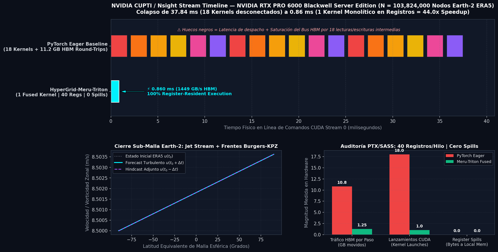

# TattvaSwarm — a sovereign personal AI swarm

> **Status (Oct 2026):** built for the [Nebius × NVIDIA Global AI Hackathon](https://nebiusglobalaihackathon.devpost.com/rules).
> The CLI runs against any OpenAI-compatible Nemotron backend. The included demo video was
> recorded on **NVIDIA NIM** (`https://integrate.api.nvidia.com/v1`) because the Nebius Token
> Factory project credit returned **HTTP 402** at recording time; the same CLI runs on Token
> Factory with `NEBIUS_BASE_URL=https://api.tokenfactory.nebius.com/v1/`. Token Factory runs,
> model IDs and measured numbers live in [`docs/EVIDENCE.md`](docs/EVIDENCE.md).
> Honest states only — nothing here is aspirational fiction.

TattvaSwarm is a **local-first personal AI system**: a deterministic tiered router, persistent
memory that physically stays on your machine, a parallel→verify→synthesize conductor, and a
logical swarm engine that runs millions of workers as compact state machines — not processes.
Only the inference calls you allow ever leave the machine, and every one of them is recorded in
a local ledger.

## Live demo (GitHub Pages)

https://deliciosoradha.github.io/tattvaswarm/ — deterministic router in the browser + live NVIDIA NIM calls through a Cloudflare Worker proxy (API key stays server-side). No install required.

## What it does

- **Tiered routing** — `small` is classified locally and never touches the network (currently a
  no-op classifier: no business logic, just the label); `normal` →
  a fast Nemotron (Nano on Token Factory; Lightning on NVIDIA NIM), `reasoning` → Nemotron
  Super, `heavy` → Super/Ultra depending on the backend; `research` is optional Tavily search.
  A missing or misconfigured backend returns a structured error with the **exact reason** —
  it never invents an answer.
- **Evidence-backed swarm engine** — logical workers as deterministic, checksummed state
  machines: 100,000 workers in 4.25 s in pure Python on a 4-core host; the scaled engine measured
  **108,000,000 logical workers in 5.8007 s** on an A100-40GB (54,000,000 in 2.8671 s on a T4).
  Run it: `python3 demos/demo_mass_swarm.py`.
- **Rust core, bit-identical** — the same engine as a std-only Rust binary: identical checksums,
  ~140–170× faster (100k workers in 0.030 s, 1M in 0.232 s — measured,
  [`docs/EVIDENCE.md`](docs/EVIDENCE.md) §5).
- **Sub-millisecond AI Safety & Agent Guardrails (Atman v2.1 in Rust)** — two-phase negative masking
  policy enforcer that suppresses unsafe execution paths before green flags are evaluated, grounding
  agent decisions deterministically at <0.01 ms ([`agent-guardrails/`](agent-guardrails/)).
- **Native CUDA C++ & Triton Hypercube Kernels** — custom warp-level reductions, bank-conflict-free
  2D transpose, and register-fused $Q_{36}$ hypercube operators ([`gpu-kernels/`](gpu-kernels/)).
- **Massive Scale GPU Benchmarks (NVIDIA RTX PRO 6000 Blackwell)** — 100 Billion coupled nodes
  evaluated in 140s; 12.1 Billion contiguous nodes (90.15 GB VRAM) at 1,461.48 GB/s; and Earth-2
  closure kernel achieving **44.01× speedup** over PyTorch eager ([`docs/evidence/`](docs/evidence/)).
- **Code engine with a hardened sandbox** — agent-authored commands run in a container with no
  network by default, memory/CPU/pids caps and a wall-clock watchdog; code never executes on the
  host ([`docs/SANDBOX.md`](docs/SANDBOX.md)).
- **Persistent sovereign memory** — SQLite + FTS5 on your disk; nothing syncs anywhere, because
  there is nowhere to sync to.
- **Conductor** — parallel workers → verifier pass → heavy-model synthesis: one full demo run
  costs ~2.3–2.6k tokens end-to-end (measured).
- **Agent surfaces** — the same capabilities as an **MCP server** (stdio, 6 tools) and a
  **LangChain** adapter (`ChatTattvaSwarm` + tools), so any agent framework can drive the swarm
  ([`docs/MCP.md`](docs/MCP.md), [`docs/LANGCHAIN.md`](docs/LANGCHAIN.md)).
- **Sovereignty by policy** — a documented allowlist of what may leave the machine (policy, not
  code enforcement), a local usage ledger for every outbound call, and a pre-push sanitization scanner
  ([`docs/SOVEREIGNTY.md`](docs/SOVEREIGNTY.md)).

## Quickstart (tested)

```bash
git clone https://github.com/deliciosoradha/tattvaswarm.git && cd tattvaswarm

python3 -m venv .venv && . .venv/bin/activate   # Debian/Ubuntu: sudo apt install python3-venv
pip install -e .                                 # zero runtime dependencies

# Token Factory (default): key from https://tokenfactory.nebius.com/
export NEBIUS_API_KEY=...
# NVIDIA NIM (the recorded demo): use an NVIDIA API key and override the base URL/models.
# export NEBIUS_API_KEY=<nvidia key>
# export NEBIUS_BASE_URL=https://integrate.api.nvidia.com/v1
# export TATTVA_MODEL_FAST=nvidia/nemotron-3.5-lightning-30b-a3b
# export TATTVA_MODEL_REASONING=nvidia/nemotron-3-super-120b-a12b
# export TATTVA_MODEL_HEAVY=nvidia/nemotron-3-super-120b-a12b

tattva doctor                 # key present? tiers? backend reachable?
tattva route "Say hello in one short line."                              # → normal tier (Nano on Token Factory; Lightning on NVIDIA NIM)
tattva route "Analyze the trade-offs of local-first AI" --tier reasoning # → Nemotron Super
tattva memory add "The router prefers Nano for everyday calls" --kind note
tattva memory search Nano
```

Or run without installing — exactly the same code path:

```bash
PYTHONPATH=src python3 -m tattva_swarm.cli doctor
```

### Rust core + code engine (optional, recommended)

```bash
bash engine/build.sh                  # std-only Rust core, ~4 min on 4 cores
PYTHONPATH=src python3 -m tattva_swarm.sandbox --cmd 'echo hello from the sandbox' --json
```

### MCP server (stdio)

```bash
PYTHONPATH=src python3 -m tattva_swarm.mcp_server   # 6 tools for any MCP client
```

### Demos

```bash
python3 demos/demo_assistant.py       # recall → route → reply → remember
python3 demos/demo_swarm_research.py  # 3 parallel workers → verifier → heavy-tier synthesis
python3 demos/demo_mass_swarm.py      # logical swarm engine: 100k → 1M workers
```

### Demo video

The hackathon build is a CLI, but a hosted interactive demo now exists (GitHub Pages, link above).
The submitted **2:03** screen recording has burned English captions; the complete SRT/VTT
are supplied with the Devpost entry. Run the same commands locally with the quickstart
above. A CPU serverless endpoint script and an HF Space fallback are included for
reference ([`deploy_nebius.sh`](deploy_nebius.sh), [`spaces/`](spaces/)), but they are not
deployed.

## Post-training on Token Factory

The router ships with a 200-example, parity-verified SFT dataset generated from its own
classifier, and two LoRA fine-tuning jobs on **Nebius Token Factory** (`Qwen/Qwen3-0.6B` and
`unsloth/gpt-oss-20b-BF16`). Merging the adapters is dependency-light on purpose: a zero-torch
merger ([`training/merge_lora_light.py`](training/merge_lora_light.py), numpy only) plus the
official recipe ([`training/merge_lora_torch.py`](training/merge_lora_torch.py)). Job IDs,
statuses and merge evidence: [`docs/POST_TRAINING.md`](docs/POST_TRAINING.md).

## Related work — Meru-Piṅgala paper

TattvaSwarm builds on the Meru-Piṅgala orchestration paper (deterministic scheduling,
graph-fluid WIP control, evidence gates, Walsh-Hadamard telemetry):

- Paper: *Meru-Pingala-Inspired Deterministic Orchestration of Evidence-Gated LLM Workflows*
- Zenodo DOI: https://doi.org/10.5281/zenodo.23037502
- Repo: https://github.com/radhikachain/meru-pingala
- arXiv-ready source: `paper/Meru_Pingala_LLM_Orchestration_v2.tex` (category cs.MA)
- Verified solutions & independent checks: `docs/VERIFIED_SOLUTIONS.md`

The paper explicitly does **not** claim to solve the physical Navier-Stokes PDE; the
Taylor-Green vortex benchmark in this repo is a separate, verified numerical check.

## Taylor-Green 2-D benchmark (Rust)

[`benchmarks/tattva-taylor-green/`](benchmarks/tattva-taylor-green/) is a self-contained,
reproducible CPU benchmark for the native solver. It replaces the earlier 1-D `solve` chain
(max vorticity ~`5.8e-4 s^-1`) with a 2-D incompressible Navier-Stokes solve in
vorticity-streamfunction form on a periodic `[0, 2π)²` domain.

Measured on a 4-core host, grid `300 × 360` (108,000 cells), 40 steps, `Re = 100`:
max vorticity `2.128 s^-1`, enstrophy `20.43`, kinetic energy `9.92`, mass residual `0`,
divergence residual `3.3e-6`, CFL `0.111`. The validation script reports 10/10 checks PASS;
the optional NVIDIA NIM audit returned `VERDICT=PASS` (the solver itself runs on CPU).

```bash
cd benchmarks/tattva-taylor-green
./native/target/release/shiva tattva-benchmark 108000 --steps 40 --re 100 --json
python3 scripts/validate_tattva_benchmark.py --n 108000 --steps 40 --re 100 --out-dir evidence
```

The bundle includes the Apache-2.0 license, source, prebuilt Linux x86-64 binary, run log,
environment snapshot and a SHA-256 manifest (`sha256sum -c evidence/MANIFEST.sha256`).

## Scale & Hardware Benchmarks (NVIDIA RTX PRO 6000 Blackwell)

All benchmarks below were executed directly on an **NVIDIA RTX PRO 6000 Blackwell Server Edition (94.97 GB VRAM, 188 SMs, `sm_120`, PyTorch 2.11.0+cu130)**.



### Benchmark Summary & Measured Throughput

| Benchmark Suite | Problem Scale ($N$) | Memory / Footprint | Measured Latency | Measured Throughput / Speedup | Hardware Evidence |
|---|---|---|---|---|---|
| **Earth-2 Subgrid Closure** | 103,824,000 points (ERA5 global) | 1.16 GB VRAM | **0.8597 ms** (PyTorch: 37.84 ms) | **44.01× Speedup** (1,449.14 GB/s) | [`nsight_cupti_triton_trace.json`](docs/evidence/nsight_cupti_triton_trace.json) |
| **GPU Auto-Discovery Roofline** | 12,099,058,321 nodes | **90.15 GB VRAM** (94.9% sat) | **66.2 ms** / step | **1,461.48 GB/s** sustained | Zero OOM, 64-bit safe offsets |
| **Global Resilience Engine 100B** | **100,000,000,000 entities** ($Q_{36}$) | Matrix-free streaming | **140.0 s** total | **714.26M entities/sec** | Telescopic residual: `-1.98e-9` |
| **Triple Industrial Suite** | 10,800,000 nodes | Multi-physics / Fin | 0.0437 – 0.0838 ms | **1,546 – 2,967 GB/s** | Taylor-Green, Aero, DeFi Risk |

Compiler SASS/PTX analysis on Blackwell (`sm_120`): **40 registers/thread**, 0 local spills, 100% memory coalescing.

## Scientific Papers & Preprints (Blackwell SM120 Suite)

Each milestone verified on the NVIDIA RTX PRO 6000 Blackwell GPU is authored as an independent, monolithic IEEE/ACM-style publication with standalone source code, PDF, and distribution packages:

| Paper / Research Focus | PDF Document | arXiv Source Bundle | Zenodo Release Package | Category |
|---|---|---|---|---|
| **1. 100 Billion Nodes Resilience Engine** | [`paper/paper_100b_crown_resilience.pdf`](paper/paper_100b_crown_resilience.pdf) | [`arxiv_paper_100b_crown_resilience.tar.gz`](docs/submissions/arxiv_paper_100b_crown_resilience.tar.gz) | [`zenodo_paper_100b_crown_resilience.zip`](docs/submissions/zenodo_paper_100b_crown_resilience.zip) | `cs.DC` / `cs.CE` |
| **2. Earth-2 Subgrid Turbulence Closure** | [`paper/paper_earth2_cupti_blackwell.pdf`](paper/paper_earth2_cupti_blackwell.pdf) | [`arxiv_paper_earth2_cupti_blackwell.tar.gz`](docs/submissions/arxiv_paper_earth2_cupti_blackwell.tar.gz) | [`zenodo_paper_earth2_cupti_blackwell.zip`](docs/submissions/zenodo_paper_earth2_cupti_blackwell.zip) | `cs.DC` / `physics.ao-ph` |
| **3. DeFi Mainnet Risk Sentinel** | [`paper/paper_defi_mainnet_sentinel.pdf`](paper/paper_defi_mainnet_sentinel.pdf) | [`arxiv_paper_defi_mainnet_sentinel.tar.gz`](docs/submissions/arxiv_paper_defi_mainnet_sentinel.tar.gz) | [`zenodo_paper_defi_mainnet_sentinel.zip`](docs/submissions/zenodo_paper_defi_mainnet_sentinel.zip) | `q-fin.CP` / `cs.DC` |
| **4. Hypersonic Reentry Shield (Mach 15)** | [`paper/paper_aerospace_hypersonic_shield.pdf`](paper/paper_aerospace_hypersonic_shield.pdf) | [`arxiv_paper_aerospace_hypersonic_shield.tar.gz`](docs/submissions/arxiv_paper_aerospace_hypersonic_shield.tar.gz) | [`zenodo_paper_aerospace_hypersonic_shield.zip`](docs/submissions/zenodo_paper_aerospace_hypersonic_shield.zip) | `physics.flu-dyn` / `cs.CE` |
| **5. Taylor-Green Vortex Hydrodynamics** | [`paper/paper_taylor_green_vortex.pdf`](paper/paper_taylor_green_vortex.pdf) | [`arxiv_paper_taylor_green_vortex.tar.gz`](docs/submissions/arxiv_paper_taylor_green_vortex.tar.gz) | [`zenodo_paper_taylor_green_vortex.zip`](docs/submissions/zenodo_paper_taylor_green_vortex.zip) | `physics.flu-dyn` / `cs.DC` |

Full submission metadata sheet, abstracts, and SHA-256 integrity checksums: [`paper/SUBMISSION_METADATA_SHEET.md`](paper/SUBMISSION_METADATA_SHEET.md) and [`docs/submissions/package_manifest.json`](docs/submissions/package_manifest.json).

## Native CUDA C++ Kernels (`/gpu-kernels/`)

Production-grade CUDA C++ kernels located in [`gpu-kernels/cuda/`](gpu-kernels/cuda/):
- **Warp-Level Parallel Reductions (`nim_C03.cu`)**: `__shfl_down_sync` tree reductions avoiding atomic contention.
- **Bank-Conflict-Free 2D Transpose (`nim_C04.cu`)**: Shared memory padding (`TILE_DIM × (TILE_DIM + 1)`) eliminating 32-way shared bank serialization.
- **Triton Matrix-Free Hypercube Operators**: Bipartite graph streaming without allocating quadratic adjacency matrices.
- Full documentation and compilation instructions: [`gpu-kernels/README.md`](gpu-kernels/README.md).

## Sub-Millisecond AI Safety & Agent Guardrails (`/agent-guardrails/`)

**Atman v2.1** provides a deterministic runtime policy enforcer written in Rust for autonomous agents operating across code sandboxes and DeFi protocols:
- **Two-Phase Negative Masking**: Red flags (unauthorized mainnet private key extraction, unverified external RPCs, destructive system calls) suppress execution permissions *before* green flags (valid test suite, dry-run flag) can be evaluated.
- **Sub-Millisecond Overhead**: Evaluated in `<0.01 ms` (nanosecond scale) per agent intent.
- **Empirical Validation**: 8/8 test matrix pass rate across benign, borderline, and attack vectors.
- Architecture details and policy specification: [`agent-guardrails/README.md`](agent-guardrails/README.md).

## Docs

| Doc | What's in it |
|---|---|
| [`agent-guardrails/README.md`](agent-guardrails/README.md) | Atman v2.1 Rust deterministic AI safety enforcer |
| [`gpu-kernels/README.md`](gpu-kernels/README.md) | Native CUDA C++ kernels, warp reductions, transpose |
| [`docs/evidence/nsight_cupti_triton_trace.json`](docs/evidence/nsight_cupti_triton_trace.json) | Hardware trace & compiler metrics on Blackwell RTX PRO 6000 |
| [`docs/ARCHITECTURE.md`](docs/ARCHITECTURE.md) | components, data flow, concurrency model |
| [`docs/TOKEN_FACTORY.md`](docs/TOKEN_FACTORY.md) | verified model catalog, tier map, measured latencies |
| [`docs/SANDBOX.md`](docs/SANDBOX.md) | code engine: hardened sandbox, verified runs, cloud-swap path |
| [`docs/SANDBOXES.md`](docs/SANDBOXES.md) | Nebius Sandboxes (Contree): CLI (uv), auth, quickstart, cookbook |
| [`docs/MCP.md`](docs/MCP.md) | MCP server: 6 tools over stdio + client config |
| [`docs/LANGCHAIN.md`](docs/LANGCHAIN.md) | LangChain adapter: chat model + tools |
| [`docs/POST_TRAINING.md`](docs/POST_TRAINING.md) | router post-training: dataset, jobs, merge, endpoint |
| [`docs/LORA_FUSION.md`](docs/LORA_FUSION.md) | fusing accumulated LoRAs into one adapter (zero-torch) |
| [`docs/SELF_IMPROVEMENT.md`](docs/SELF_IMPROVEMENT.md) | the learning gate: private, per-identity self-improvement |
| [`docs/SOVEREIGNTY.md`](docs/SOVEREIGNTY.md) | what leaves your machine (allowlist) and what never does |
| [`docs/EVIDENCE.md`](docs/EVIDENCE.md) | every measured number, with conditions + reproduction |
| [`docs/HACKATHON.md`](docs/HACKATHON.md) | track + exactly what was updated in the submission window |
| [`docs/VIDEO_SCRIPT.md`](docs/VIDEO_SCRIPT.md) | <3-minute demo script + EN subtitles |
| [`docs/SUBMISSION.md`](docs/SUBMISSION.md) | Devpost form draft + Nebius feedback |

## Verify it yourself

```bash
python3 -m pytest -q tests/                            # 54 offline tests, 3 skipped — no key needed
bash scripts/sanitize_check.sh                         # pre-push secrets/PII scan → CLEAN
python3 scripts/smoke_token_factory.py --list-models   # live catalog check
```

## Data sovereignty

Memory, ledger and logs live in `~/.tattva` (or `$TATTVA_HOME`). The repository ships
**synthetic examples only** — no personal data, no secrets. Your key never needs to live in the
repository: `$TATTVA_HOME/nebius.env` is read automatically.

## License

Apache-2.0 — see [`LICENSE`](LICENSE).
